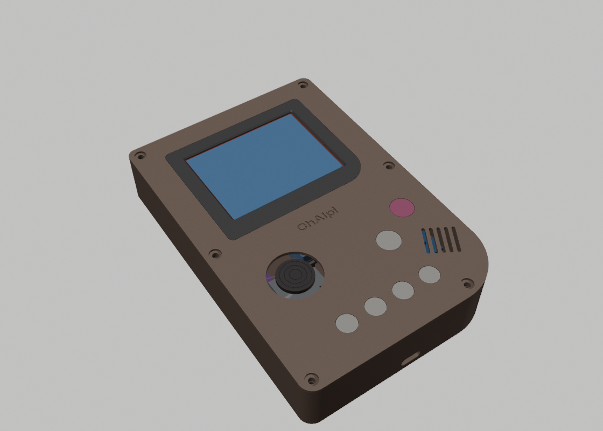
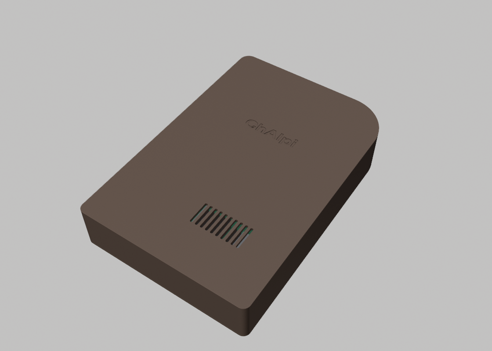
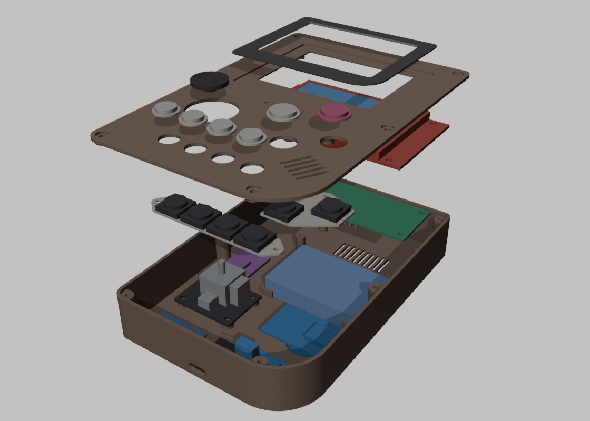
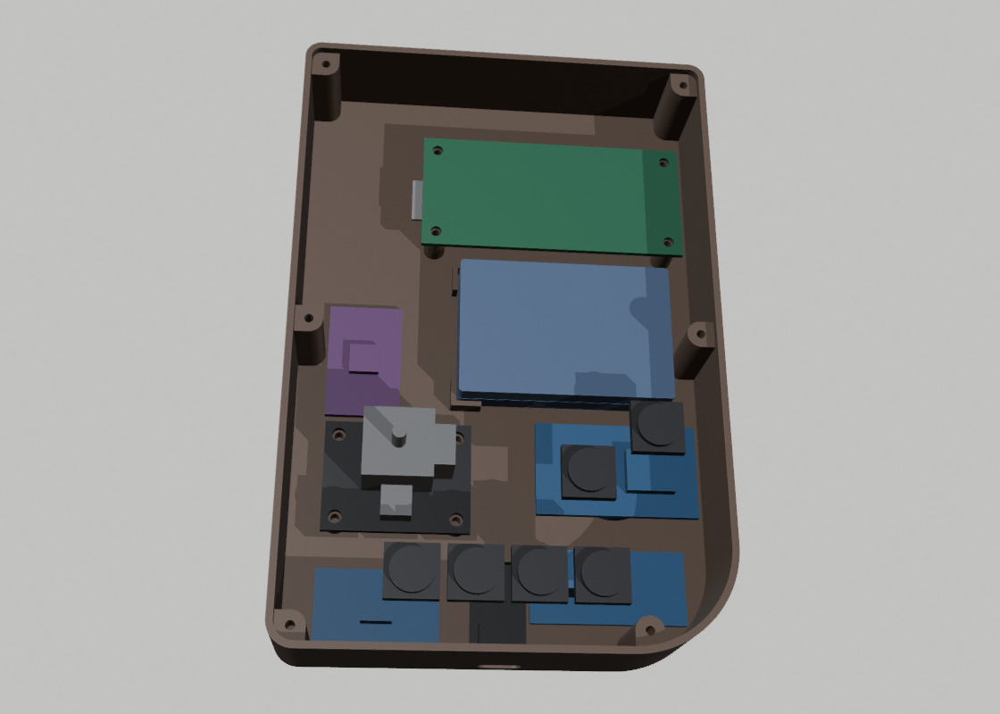

# ChAIpi portrait case: a Game Boy-style slab



A one-piece case shaped like a classic handheld: the screen at the top, controls underneath, and the big rounded bottom-right corner. Same parts and same screws as the [clamshell](../case/README.md) and the [landscape case](../case-landscape/README.md). Pick whichever shape you like; the electronics and the OS don't change.

- **Front:** the screen in a dark surround, the joystick where a D-pad would be, Undo and Confirm as the "B" and "A" keys, and Fn, Tab, Menu and Esc along the bottom.
- **Inside:** everything lies flat on the back. The Pi sits upside down under the screen, with its heatsinks over vent slots in the back.
- **Fastening:** your laptop screw kit (M2 / M2.5) threads straight into the printed plastic. No nuts or inserts.

| | |
|---|---|
| Size | 100 × 148 × **25.9 mm** |
| Screen window | 58.6 × 44.2 mm over the 57.6 × 43.2 mm picture, centred |
| Checked by script | No part cuts into another ([tools/fit_report.txt](tools/fit_report.txt)) |

> [!IMPORTANT]
> **Not printed yet.** Same part sizes as the clamshell (the official drawings, your measurements and product photos). Print the clamshell's [fit test](../case/stl/fit_test.stl) first: it checks the same screw holes and cap holes this case uses.

<table>
<tr><td></td><td></td></tr>
<tr><td align="center"><sub>Back: vents under the Pi's heatsinks</sub></td><td align="center"><sub>Exploded: tub and parts, Pi, button carriers, screen, top plate, surround, caps</sub></td></tr>
<tr><td colspan="2" align="center"></td></tr>
<tr><td colspan="2" align="center"><sub>Inside (top plate and screen off)</sub></td></tr>
</table>

## How it's laid out

| Where | What |
|---|---|
| **Top half** | The screen hangs from the top plate on four posts, screwed through its own corner holes. Under it: the Pi, upside down on four posts, and the top of the battery |
| **Left** | The joystick on four pads. Above it: the ADS1115 |
| **Right** | Undo and Confirm on one carrier. Under them: the DS3231 clock, and the battery block (wires out to the left) |
| **Bottom** | Fn, Tab, Menu and Esc on a second carrier. Under them: the TP4056 charger, the USB-C breakout (port in the middle of the bottom edge) and the MT3608 boost under the grille slots, which are vents here (there's no speaker) |
| **Back** | Vent slots right under the Pi's two heatsinks, and the ChAIpi wordmark |

## Files

| File (`stl/`) | Print | Notes |
|---|---|---|
| `tub.stl` | 1 | Back and walls. Prints back-down (the wordmark is on the bed) |
| `top_plate.stl` | 1 | Exported face-down: the visible face is on the bed |
| `screen_surround.stl` | 1 | The dark surround. Exported face-down. Print it in black or dark grey and glue it into its pocket |
| `button_carrier_face_buttons.stl` | 1 | Holds Undo and Confirm |
| `button_carrier_small_keys.stl` | 1 | Holds Fn, Tab, Menu and Esc |
| `button_caps.stl` | 1 set | Six caps: Confirm and Undo 10.5 mm, the rest 8.5 mm |
| `joystick_cap.stl` | 1 | Low cap that replaces the tall PS2 cap |
| `assembly.stl` | for looking | Every part and component in place, as one file |
| `components/*.stl` | for looking | Rough models of each bought part, in place |
| `assembled/*.stl` | for looking | One file per part in its finished place. Import them all into one Tinkercad design and they land put together (the [clamshell guide](../case/README.md#the-whole-device-in-tinkercad) explains how) |

Also here: `chaipi-portrait.glb` (a coloured 3D model; press space on it in Finder for Quick Look) and `renders/`.

## Printing (Ender 3 V3 SE)

Same settings as the clamshell: PLA or PETG, 0.4 mm nozzle, 0.2 mm layers, 3 walls, 20 % infill, no supports. Every part is exported in the orientation it prints in. The tub and the top plate fit the 220 × 220 mm bed. Every screw post stands on the back, so nothing needs support.

## Screws (all from your XIKKART kit)

| Where | Screw | How many |
|---|---|---|
| Top plate → tub (from the front) | M2.5 × 8 | 6 |
| Screen → top plate posts (from behind the screen) | M2.5 × 5 | 4 |
| Pi → tub posts | M2.5 × 5 | 4 |
| Joystick board → tub pads | M2.5 × 5 | 4 |
| Button carriers → top plate | M2 × 4 | 4 |

That's 22 screws. The boards without mounting holes (clock, boost, charger, ADC, USB-C) are held with double-sided foam tape; four low corner ribs keep the battery in place.

## Putting it together

1. **Prepare the parts** as for the clamshell: the joystick's and the screen's headers come off, the ZS-042's charging resistor comes off, and the MT3608 is set to **5.1 V** before it touches the Pi.
2. **Wire it on the bench first**, following [the circuit](../../docs/wiring/circuit.svg) and the [wiring guide](../../docs/03-wiring.md).
3. **Tub:** battery between its corner ribs (foam tape under it); joystick on its pads (4 screws); clock, boost, charger, ADC and USB-C on foam tape, with the USB-C port pushed into the bottom opening; then the Pi, **heatsinks down**, on its four posts (4 screws).
4. **Top plate**, face down on the desk:
   - Glue the screen surround into its pocket (on the other side) first.
   - Lay the screen face down on its four posts and screw it on.
   - Drop the caps into their holes, seat the switches in the two carriers, solder their wires, and screw the carriers on (2 × M2 each).
5. **Close it:** connect everything (leave the screen's wires a little slack so the plate can open like a book), turn the plate over onto the tub, fit the 6 front screws, and press the joystick cap onto the stick.

## Changing it

Every position is in [tools/layout.py](tools/layout.py); the shared maths and part sizes are in [../tools/slab.py](../tools/slab.py) (which reads the part sizes from the clamshell's layout, so a size you correct there reaches all three cases). Check a change without Blender:

```bash
python3 enclosure/case-portrait/tools/layout.py
```

Then rebuild the parts, the checks and the pictures:

```bash
/Applications/Blender.app/Contents/MacOS/Blender --background --factory-startup --python enclosure/tools/build_slab.py -- enclosure/case-portrait
```
