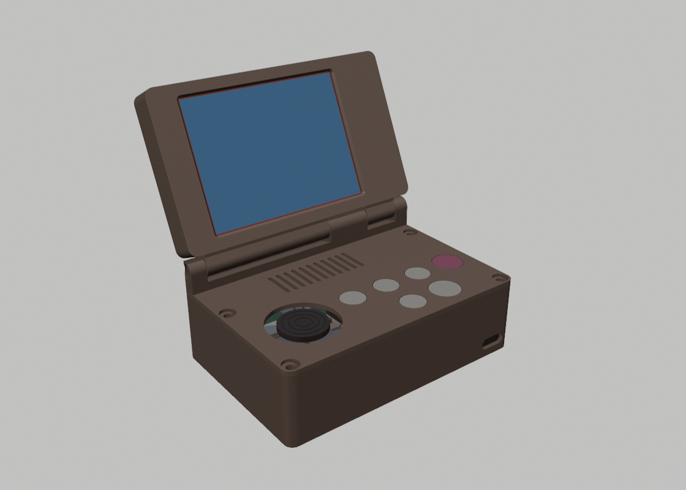
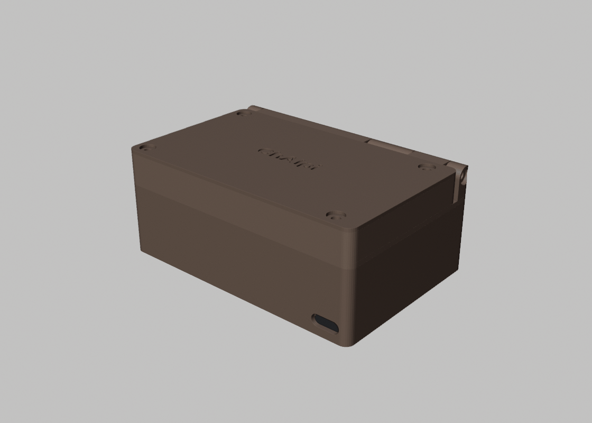
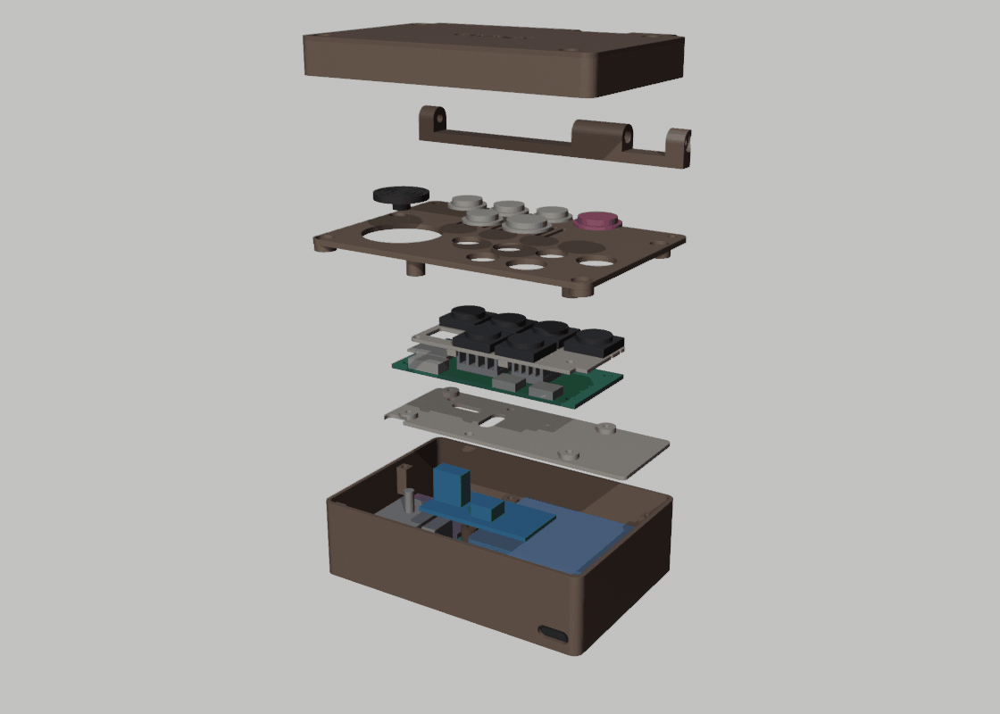
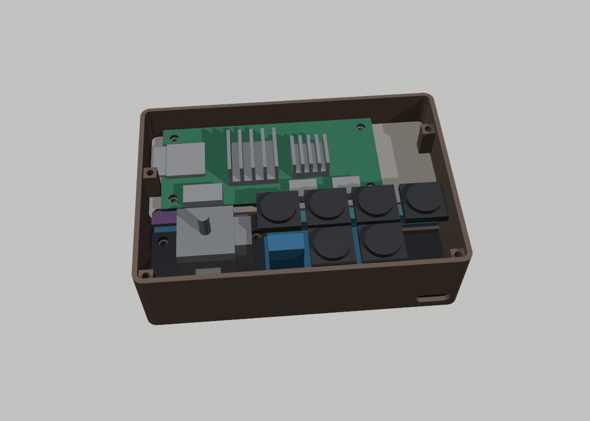
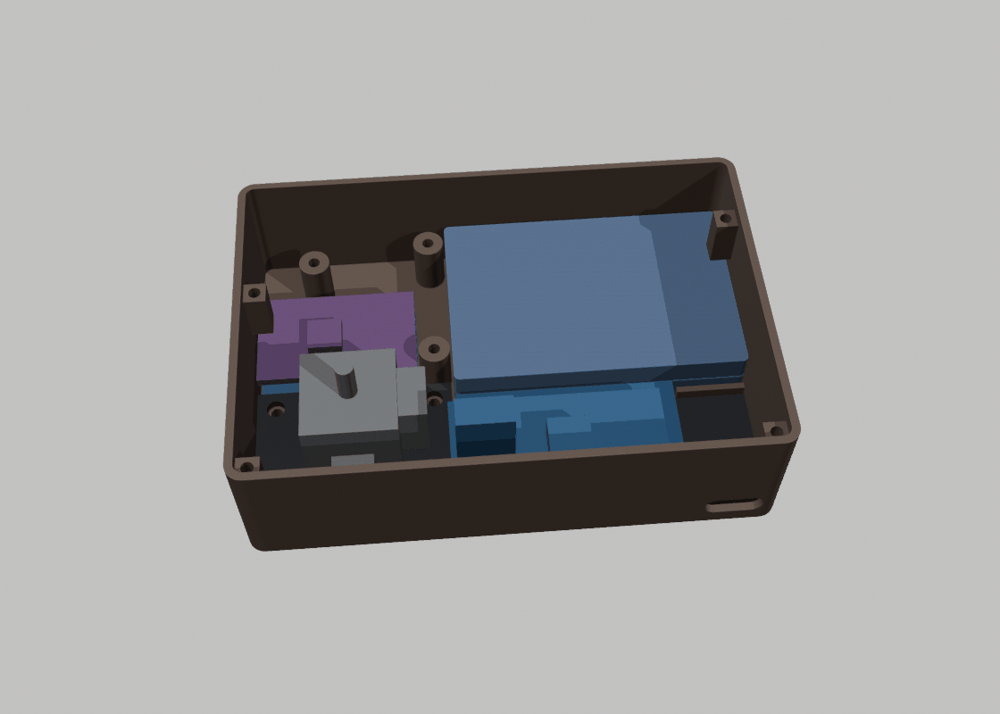

# ChAIpi case (revision 1): a slim clamshell



A fold-open case, like a Game Boy Advance SP. Prefer a one-piece shape? The same parts also fit the Game Boy-style [portrait case](../case-portrait/README.md) and the [landscape case](../case-landscape/README.md).

- **Lid:** only the screen, with thin side bezels.
- **Base:** everything else, and no bigger than the lid. The hinge barrel sits along the back edge.
- **Fastening:** your laptop screw kit (M2 / M2.5) threads straight into the printed plastic. No nuts or inserts needed.
- **Hinge:** no hinge to buy. It pivots on two M2.5 × 8 screws from the kit.

| | |
|---|---|
| Closed | 89.2 × 60.5 × **36.3 mm** |
| Base | 89.2 × 60.5 × 25.9 mm (lid 89.2 × 53.2 × 10.4 mm, plus the hinge) |
| Screen window | 58.6 × 44.2 mm over the 57.6 × 43.2 mm picture |
| Checked by script | No part cuts into another when closed. The lid swings freely from 0° to 180°. ([tools/fit_report.txt](tools/fit_report.txt)) |

> [!IMPORTANT]
> **Not printed yet.** Sizes come from the official drawings (Pi Zero 2 W, the MSP2807 screen, the joystick), your measurements (cells, buttons, heatsinks) and product photos. Print the **fit test** first, and check the few sizes in [Before you print](#before-you-print). Expect to tweak a hole or two after the first real print.

<table>
<tr><td></td><td></td></tr>
<tr><td align="center"><sub>Closed</sub></td><td align="center"><sub>Exploded: tub, boards, middle sheet, Pi, buttons, top plate, hinge, lid</sub></td></tr>
<tr><td></td><td></td></tr>
<tr><td align="center"><sub>Inside (top plate off)</sub></td><td align="center"><sub>Bottom layer (Pi and sheet off)</sub></td></tr>
</table>

## How it's laid out

| Where | What |
|---|---|
| **Lid** | The screen, face down on the bezel, on four posts. The back cover screws through the screen's own corner holes into those posts, so the same four screws hold the screen and the cover |
| **Base, bottom layer** | Front-left: joystick, its board on 2.4 mm pads. Front-right: DS3231 clock, with the MT3608 boost on top of it and the USB-C breakout in the corner (port in the front edge). Back-right: the two cells, taped together. Back-left: TP4056 charger with the ADS1115 on top |
| **Middle sheet** | Sits over the battery on three posts and carries the Pi (four screws into pucks with blind holes, so no screw tip points at the battery) |
| **Top plate** | Joystick hole, six button holes, vent slots over the Pi's heatsinks (the lid covers them when closed). The button carrier hangs under it |
| **Hinge** | Hinge block on the base's back edge: three posts. Lid: two knuckles. Pivots: two M2.5 × 8 screws, one from each side. The screen's wires pass through the middle of the barrel, so opening the lid twists them gently instead of bending them |

Buttons (front of the device at the bottom):
```
 [Tab] [Menu] [Esc]  [CONFIRM]
       [Fn]   [UNDO]
```
The two empty spots are deliberate. One sits over the boost board's tall trimmer, and the other leaves room for a corner screw.

## Files

| File (`stl/`) | Print | Notes |
|---|---|---|
| `fit_test.stl` | 1 | **Print this first.** Three M2.5 and three M2 pilot-hole sizes, clearance holes and a cap hole |
| `base_tub.stl` | 1 | Floor and walls |
| `base_top_plate.stl` | 1 | Exported face-down: the visible face is on the bed |
| `button_carrier.stl` | 1 | Holds the six switches |
| `button_caps.stl` | 1 set | Six caps: Confirm and Undo 10.5 mm, the rest 8.5 mm |
| `joystick_cap.stl` | 1 | Low cap that replaces the tall PS2 cap |
| `middle_sheet.stl` | 1 | Your middle sheet, carrying the Pi |
| `hinge_block.stl` | 1 | Print at 100 % infill: it carries the lid |
| `lid_frame.stl` | 1 | Exported screen-face-down; four walls recommended |
| `lid_back_cover.stl` | 1 | Exported outer face down (the ChAIpi wordmark is on the bed) |
| `assembly_closed.stl` | for looking | Every part and component in place, as one solid. Open it in Tinkercad or on GitHub to see how everything fits |
| `components/*.stl` | for looking | Rough models of each bought part, in their assembled positions |
| `assembled/*.stl` | for looking | The finished device with the lid open, one file per part (19 files). Import them all into one Tinkercad design and they land already put together ([how](#the-whole-device-in-tinkercad)) |

Also here:
- `chaipi-case.glb`: a coloured 3D model with the lid open. Press space on it in Finder for Quick Look.
- `renders/`: the pictures above.
- `tools/`: the scripts that make all of this (see [Changing it](#changing-it)).

## Printing (Ender 3 V3 SE)

- **Material:** PLA or PETG. PETG is a little tougher at the hinge and the screw holes.
- **Basics:** 0.4 mm nozzle, 0.2 mm layers (0.12 mm for the caps and joystick cap if you like a smoother top), 3 walls (4 for the lid frame), 20 % infill, hinge block 100 %.
- **Supports:** none. Every part is exported in the orientation it prints in, flat side down. Just place it in Cura and slice.
- **Brim:** optional for the tub if its corners lift.
- **Holes:** the screw holes are designed small on purpose, so the screws cut their own threads. Drive each screw in slowly the first time.

## Screws (all from your XIKKART kit)

| Where | Screw | How many |
|---|---|---|
| Top plate → tub (corners, from the top) | M2.5 × 8 | 4 |
| Lid back cover + screen → lid posts | M2.5 × 8 | 4 |
| Hinge pivots (one from each side) | M2.5 × 8 | 2 |
| Hinge block → top plate (from inside) | M2.5 × 5 | 4 |
| Middle sheet → tub posts | M2.5 × 5 | 3 |
| Joystick board → tub pads | M2.5 × 5 | 3 (the 4th corner sits on a pin) |
| Pi → middle sheet | M2.5 × 3.5 | 4 |
| Button carrier → top plate | M2 × 4 | 2 |

That's 26 screws. The kit has 50 of each size.

The boards without mounting holes (clock, boost, charger, ADC, USB-C) sit in their spots and are held by the parts around them. Put a strip of double-sided foam tape under each one, and one on top of the battery under the middle sheet.

## Before you print

These sizes vary between sellers. Measure yours; if any is off by more than about 0.5 mm, tell me and I'll regenerate the files (it takes seconds):

1. **Joystick board:** stick centre about **16.9 mm** from the pin edge and **8.5 mm** from the nearer long edge. Mounting holes about **3.2 mm** in from each corner.
2. **Joystick stick tip:** the flat part the cap grips. The cap's slot is **2.1 × 4.6 mm**, 4 mm deep. If the cap is loose, a drop of glue fixes it.
3. **MT3608 boost:** 36 × 17 mm. Its trimmer (the small blue box with a brass screw) must end up at the **left** end, near the joystick.
4. **DS3231 clock (ZS-042):** about 38 × 22 mm and 8.6 mm tall with the coin cell. Put its 6-pin end toward the joystick.
5. **TP4056 and ADS1115:** about 28 × 17.5 mm each. **USB-C breakout:** about 12.6 × 21 mm, port at one short end.
6. **Battery block:** the two cells taped together should be no thicker than 9.6 mm.

## Putting it together

1. **Fit test.** An M2.5 screw should grip firmly in the middle-size hole, and the small cap should drop into its hole. If not, tell me which size worked.
2. **Prepare the parts:**
   - Desolder or cut off the joystick's 5-pin header, and the screen's 14-pin header. Solder wires to the pads.
   - On the ZS-042, remove the charging resistor, then fit the CR2032 with + up.
   - Set the MT3608 to **5.1 V** before it ever touches the Pi.
3. **Wire it on the bench first**, following [the circuit](../../docs/wiring/circuit.svg) and the [wiring guide](../../docs/03-wiring.md), and test each step there.
4. **Tub:**
   - Battery block, back-right, with foam tape on top.
   - Joystick, front-left: 3 screws, with the 4th corner on the pin.
   - Clock on the floor, front-right, with the boost on top of it (foam tape).
   - USB-C breakout in the corner, port pushed into the front opening. The little wall behind it takes the push of the plug.
   - Charger back-left, with the ADC on top of it (foam tape).
5. **Middle sheet:** 3 screws. Then the Pi with its heatsinks, 4 screws.
6. **Top plate assembly:**
   - Drop the caps into their holes from underneath.
   - Seat the switches in the carrier (legs through the holes) and solder their wires.
   - Screw the carrier on (2 × M2). It traps the caps.
7. **Hinge and lid:**
   - Screw the hinge block onto the top plate from underneath (4 × M2.5 × 5).
   - Lay the screen face down in the lid frame. Thread its wires out through the slot in the back wall and into the right lid knuckle.
   - Put the lid's knuckles between the hinge posts, feeding the wires through the middle post and down its channel.
   - Fit the two pivot screws, then the lid back cover (4 × M2.5 × 8 through the screen's holes).
8. **Close it:** connect everything, lower the top plate assembly onto the tub, and fit the 4 corner screws. Then press the joystick cap onto the stick.

**Hinge feel:** tighten the two pivot screws until the lid stays where you leave it. If they slowly loosen, a drop of clear nail polish on the threads holds them.

## Where the wires go

| Wires | Route |
|---|---|
| Screen (8) | Lid → hinge barrel → down the middle hinge post → lands right at the Pi's header |
| Buttons (7 + GND) | From under the carrier, back over the front edge of the Pi to its header |
| Joystick | Along the left wall to the ADS1115; its press (SW) goes up through the notch at the front-left of the middle sheet |
| ADS1115, I2C | Up through the slot at the back-left of the sheet to the header's first pins |
| Clock | Up beside the joystick board (6-pin end there), over to the header |
| Power | Battery → charger (back-left) → boost (front-right) along the floor beside the battery, through the sheet's middle slot. 5 V from the boost back to header pins 2/4, with the capacitor near the Pi |
| USB-C | VBUS/GND to the charger; D+/D− to the Pi's **USB_DP / USB_DM** test pads (underneath, next to the USB socket) before the Pi is screwed down. A micro-USB plug doesn't fit in this case |

Use thin, soft silicone wire (28–30 AWG) for everything except the battery and 5 V lines (24 AWG). Leave a little slack through the hinge.

## Editing it in Tinkercad

Tinkercad has no way for a script to build designs in it, but the STL files import straight in:

1. Go to **tinkercad.com** → sign in → **Create** → **3D design**.
2. Click **Import** (top right) → **Choose a file** → pick a file from `enclosure/case/stl/` → Units **Millimeters**, Scale **100 %** → **Import**.
3. To cut a hole or add material:
   - Drag a shape (for example a **Cylinder**) from the right-hand panel and set it to **Hole** (or **Solid**).
   - Place it, select it together with the part, then click **Group** (Ctrl + G).
4. When you're happy, use **Export** → **.STL** and print that file.

**Onshape:** it turns STL files into meshes it can't edit like normal parts, so Tinkercad is the easier place for these files. For bigger changes, ask me and I'll change the script. It rebuilds every part, re-runs the collision and swing checks, and re-renders the pictures.

### The whole device in Tinkercad

Make a new design and import all 19 files from `stl/assembled/`, one at a time (Millimeters, 100 %). They land already put together, like the finished device with its lid open, and each part stays its own shape, so you can hide, recolour or move it.

How they line up: every file carries the same two tiny 0.4 mm cubes at the same two far corners. So all 19 files have exactly the same outer size, and Tinkercad places them all the same way. Those two specks are markers, not part of the case.

These files are for looking and for trying changes in place. Print from the files in `stl/`: those are the right way up for the printer and have no markers.

## Changing it

Everything comes from two scripts:
- **[tools/layout.py](tools/layout.py):** every part size and position, and a quick box-collision check. Run it on its own with `python3 enclosure/case/tools/layout.py`.
- **[tools/build_case.py](tools/build_case.py):** builds the parts in Blender, checks the real shapes for collisions and the lid's swing, and writes the STL files, the GLB and the renders:

```bash
/Applications/Blender.app/Contents/MacOS/Blender --background --factory-startup --python enclosure/case/tools/build_case.py -- enclosure/case
```
